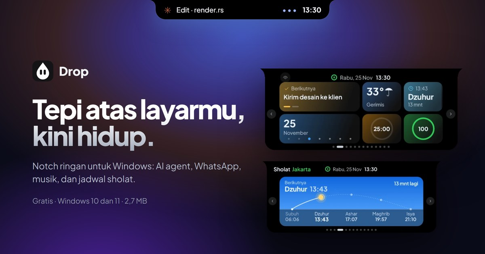

# Drop

Notch ringan di tepi atas layar Windows: progres AI agent, balas WhatsApp, musik,
jadwal sholat, kalender, tugas, dan notifikasi. Native Rust di atas Win32, tanpa
webview, memakai sekitar 20–25 MB memori.

**[Unduh Drop 0.3.1](https://github.com/rifqihilal/drop/releases/download/v0.3.1/Drop-0.3.1.0-Setup.exe)** (2,7 MB) · [Halaman Drop](https://rifqihilal.github.io/drop/) · [Semua rilis](https://github.com/rifqihilal/drop/releases)

## Baru di 0.3.1

- **Hubungkan dari Settings → AI agent:** Claude Code, OpenCode, Gemini CLI,
  Codex, Cursor, dan Hermes Agent, masing-masing sekali klik. Catatan lengkap
  ada di [rilis 0.3.1](https://github.com/rifqihilal/drop/releases/tag/v0.3.1).

## Baru di 0.3.0

- **AI agent di notch:** progres Claude Code, OpenCode, Gemini, Codex, Cursor,
  Hermes, OpenClaw, GLM, dan DeepSeek, masing-masing dengan warna dan tandanya
  sendiri. Izinkan atau tolak perintah, dan jawab pertanyaan agent langsung dari
  notch.
- **Balas WhatsApp dari notch**, tanpa membuka aplikasinya (WhatsApp Desktop resmi).
- **Home bento**, **Mixer**, **Droplate** (`Alt+C`), **Teleprompter** (`Alt+P`),
  **Istirahat**, **Pomodoro** baru, dan agenda harian di **Kalender**.
- Tema **Hitam, Kaca, atau Kaca warna**, pilihan isi kanan jam, strip unduhan,
  dan Settings baru yang gelap.

Catatan lengkap ada di [rilis 0.3.0](https://github.com/rifqihilal/drop/releases/tag/v0.3.0).

## Fitur

- **Notch tertutup:** baterai, jam, dan isi kanan pilihanmu (suhu, tanggal,
  agenda, tugas, jam kedua, Screen Time), plus strip langsung untuk agent,
  timer, acara, unduhan, dan musik.
- **AI agent:** hubungkan sekali dari Settings → AI agent, tanpa mengubah hook
  lain yang sudah ada. Beberapa agent sekaligus tampil sebagai satu strip.
- **Notifikasi:** pesan Windows di notch, klik untuk membuka tujuannya, dan
  balas WhatsApp di tempat. Volume dan kecerahan menggantikan tampilan bawaan
  Windows.
- **Kartu:** Home bento, Musik dengan lirik, Sholat (Kemenag RI), Kalender `.ics`
  dengan agenda harian, Tugas, Pomodoro, Istirahat, Mixer, Droplate,
  Teleprompter, Screen Time, dan Shelf.
- **Tampilan:** Classic atau Floating, tiga ukuran, tiga tema, sembunyi otomatis
  jadi bar tipis, bahasa Indonesia atau Inggris.
- **Tanpa akun:** semua tersimpan di komputermu sebagai berkas teks.

## Pasang

1. Unduh `Drop-0.3.1.0-Setup.exe` dari [rilis terbaru](https://github.com/rifqihilal/drop/releases/latest).
2. Jalankan. Versi lama langsung ditimpa; pengaturan, tugas, dan Screen Time
   tetap tersimpan.
3. Installer belum ditandatangani, jadi Windows SmartScreen bisa memberi
   peringatan. Pilih **More info**, lalu **Run anyway**.

Untuk Windows 10 dan 11. SHA-256 installer 0.3.1:
`d04315f559595952f75d0c9b5d99e8e310bae3bb5a9a9fff98cfd5929677f505`

## Lisensi

Drop adalah freeware buatan Hilal: gratis dipakai dan dibagikan tanpa diubah,
tidak untuk dijual atau dimodifikasi. Lihat [LICENSE](LICENSE). Repo ini hanya
berisi installer dan halaman Drop.

---

## English

Drop is a light notch for the top of the Windows screen: AI agent progress,
WhatsApp replies, music, prayer times, calendar, tasks and notifications. Native
Rust on Win32 with no webview, using about 20–25 MB of memory. The interface is
in Indonesian or English.

New in 0.3.1: connect Claude Code, OpenCode, Gemini CLI, Codex, Cursor and Hermes
Agent from Settings → AI agent in one click.

New in 0.3.0: your AI agents in the notch (Claude Code, OpenCode, Gemini, Codex,
Cursor, Hermes, OpenClaw, GLM and DeepSeek; allow or deny commands and answer
their questions there), replying to WhatsApp from the notch, a bento
Home, a per-app volume Mixer, Droplate (`Alt+C` colour picker), a Teleprompter
under the camera (`Alt+P`), break reminders, a new Pomodoro, a day's agenda on
the calendar, glass themes and a download strip.

**[Download Drop 0.3.1](https://github.com/rifqihilal/drop/releases/download/v0.3.1/Drop-0.3.1.0-Setup.exe)**
(2.7 MB, Windows 10 and 11). The installer is unsigned, so SmartScreen may warn:
choose **More info**, then **Run anyway**. Freeware by Hilal, see [LICENSE](LICENSE).
